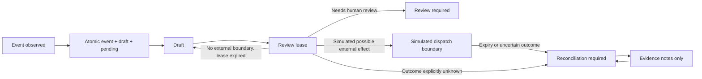

# R1.2 — Atomic inbox/outbox, review leases and uncertain outcomes

**Checkpoint:** 18 October 2026. **Status:** development code on draft PR #201; no production deployment, no provider writes, no marketplace/Shopify mutations. Core marketplace baseline: PR #200; Amazon preflight: PR #199.

## Implemented local guarantees

1. `recordInboxAndDraft` stores the event hash, immutable draft and pending index in **one Durable Object storage transaction**. Replayed identical events return `DUPLICATE`. Reused event IDs with different payloads, different command IDs or changed intent details fail closed. Reused command IDs by unrelated events fail closed. Events ingested through the older event-only route cannot later be silently adopted as if an outbox command had been committed.
2. A bounded pending index offers resumable cursor reads. A draft is **not** a command authorized to reach Amazon or Spartoo.
3. Review-only claims have persisted tokens, expiry times and atomic ownership within one Durable Object. Two workers cannot both claim the same draft. Stale tokens cannot complete reviews. Reviews end in `REVIEW_REQUIRED`, never `APPROVED`.
4. An expired local review lease can be returned to `DRAFT`. A recorded **simulated dispatch boundary** may not: on expiry it goes to `RECONCILIATION_REQUIRED`. The simulated method does not perform an HTTP request. Likewise an explicitly flagged `TIMEOUT`, `NETWORK_INTERRUPTED` or `PROVIDER_UNVERIFIED` remains quarantined.
5. Reconciliation notes are evidence *submissions*, not validated proof. They are deduplicated and can conflict, but cannot automatically turn `RECONCILIATION_REQUIRED` into success or permit retry. No remote writer, authorization transition, shipment, order import or Shopify stock update is reachable from this module.
6. All keys use tenant-scoped names and hashed provider identifiers. Only synthetic events in repository tests. Store raw customer payloads later only in dedicated, private storage after a retention and access-control review.

## State machine (R1.2, internal prototype)

There is intentionally **no** route to `AUTHORIZED`, `SENT`, `VERIFIED` or `LIVE` in this increment. The word “dispatch” in a *simulated* state represents an offline crash-safety exercise, **not** a provider operation.

## Validation criteria

- TypeScript and workerd Miniflare SQLite tests; include concurrent ingestion, conflicting event reuse, transaction rollback failure injected on third write, concurrent review claims, stale token fencing, safe review requeue, potentially external attempt quarantine, deduplicated reconciliation evidence, bounded pending cursor and persistence after runtime restart.
- No payload with real customer IDs, personal data, credentials, orders or commercial SKU mappings.
- No direct Amazon, Spartoo or Shopify outbound requests in ledger or tests.
- Fail the PR if one test fails; keep it draft after tests pass.

## Missing before production / R1.3

- A dedicated authenticated Worker boundary, verification of provider signatures/notifications and payload metadata, orders and Shopify reader integration.
- Durable alarms/watchdog with persisted scan cursors for pending and expired leases, monitoring and dead-letter processing; this manual scan API is **not** a running scheduler.
- Actual shared inventory pool identity/location routing, reservation reflection proof, order importer uniqueness by external order, and correct adoption of orders already imported by Channable.
- Server-side policy versions and real ownership handoff; no caller-supplied boolean can enable a writer. Do not switch the seller writer from Channable based on this work.
- Dedicated adapter for Amazon validation preview, schema checks, staged offer update and verified readback; Spartoo adapter only after official contract verification.
- Provider dispatch journaling and replay/idempotency rules must be reviewed independently: an offline simulated boundary is not a full production-safe dispatch implementation.

**Operational outcome:** no offer, order, shipment, tracking or quantity was sent. All progress is code and deterministic local runtime tests until the modules are integrated and authorized.
